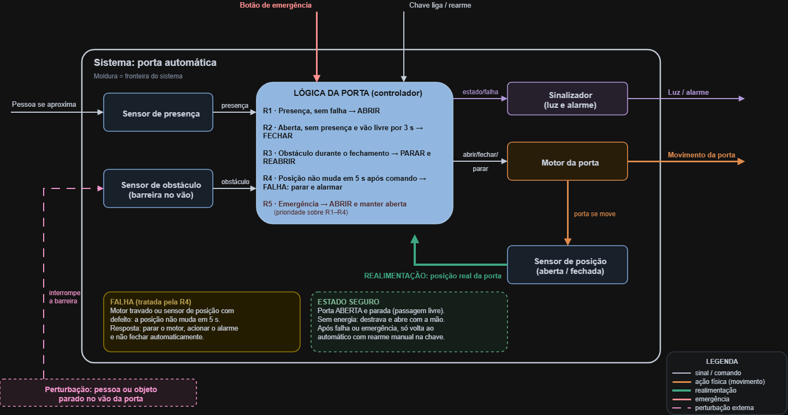

# Porta automática de acesso a um edifício

Exercício — Fundamentos dos Sistemas Automatizados.

## Objetivo

Abrir a porta automaticamente quando uma pessoa se aproxima e fechá-la com
segurança quando a passagem estiver livre. Em caso de falha ou emergência, a
porta deve ficar aberta, garantindo a passagem de pessoas.

Arquivos desta pasta:

- `diagrama.drawio` — arquivo editável (abrir em app.diagrams.net)
- `diagrama.png` — imagem do mesmo diagrama
- `README.md` — este documento

**Como ler o diagrama:** a moldura grande é a fronteira do sistema. Tudo o que
está dentro dela faz parte da porta; o que está fora é o ambiente. O sinal
percorre a figura da esquerda para a direita: **sensores → lógica → motor**.
Cada tipo de seta tem uma cor (veja a legenda no canto inferior direito):

| Seta | Significado |
|---|---|
| Branca | Sinal ou comando (informação) |
| Laranja, grossa | Ação física (a porta se move) |
| Verde, mais grossa | Realimentação (posição real da porta voltando à lógica) |
| Vermelha | Comando de emergência |
| Roxa tracejada | Perturbação vinda do ambiente |

## 1. Fronteira do sistema

**Dentro do sistema:** sensor de presença, sensor de obstáculo (barreira no vão),
lógica da porta (controlador), motor da porta, sensor de posição e sinalizador
(luz e alarme).

**Fora do sistema (ambiente):** as pessoas, os objetos no vão, o botão de
emergência do edifício e a chave de operação usada pelo responsável.

## 2. Entradas, processamento e saídas

**Entradas (vêm de fora e cruzam a fronteira):**

- Pessoa se aproxima (captada pelo sensor de presença)
- Botão de emergência
- Chave liga / rearme (liga o modo automático e serve para o rearme manual)

**Processamento — regras da lógica da porta.** Cada regra é uma condição
verificável que leva a uma ação:

| Regra | Condição | Ação |
|---|---|---|
| R1 | Há presença e não há falha | Abrir |
| R2 | Porta aberta, sem presença e vão livre por 3 s | Fechar |
| R3 | Obstáculo detectado durante o fechamento | Parar e reabrir |
| R4 | Posição não muda em até 5 s depois de um comando | Declarar falha: parar o motor e acionar o alarme |
| R5 | Botão de emergência acionado | Abrir e manter aberta |

A R5 tem prioridade sobre todas as outras. Depois da R3, a R4 também tem
prioridade sobre R1 e R2. Se a chave estiver desligada, nenhum comando
automático é enviado ao motor.

**Saídas (afetam o ambiente):**

- Movimento da porta (abrir, fechar ou parar)
- Luz / alarme (mostra o estado e avisa quando há falha)

## 3. Realimentação

O **sensor de posição** informa à lógica se a porta está realmente aberta ou
fechada. Isso fecha o laço: a lógica manda o motor abrir, o motor move a porta,
o sensor mede a posição e a informação volta para a lógica. Com isso, a lógica
**confirma** que o movimento aconteceu. Se não aconteceu, a regra R4 declara a
falha.

No diagrama, é a seta verde mais grossa, chamada *REALIMENTAÇÃO: posição real
da porta*.

## 4. Perturbação e falha

**Perturbação:** uma pessoa ou objeto parado no vão enquanto a porta fecha. O
sistema não controla isso, que vem do ambiente. A perturbação interrompe a
barreira, o sensor de obstáculo avisa a lógica e a regra R3 para e reabre a
porta. No diagrama, é a caixa rosa fora da moldura, ligada por seta tracejada.

**Falha:** motor travado ou sensor de posição com defeito. Nos dois casos, a
lógica percebe da mesma forma: mandou mover, mas a posição não mudou em 5 s
(regra R4). A resposta é parar o motor, acionar o alarme e não fechar a porta
automaticamente. No diagrama, é a caixa amarela.

| Falha | O que acontece | Como é detectada | Resposta segura |
|---|---|---|---|
| Motor travado | Porta não se move | Posição não muda em 5 s (R4) | Parar, alarmar, não fechar sozinha |
| Sensor de posição com defeito | Lógica não sabe onde a porta está | Posição não muda em 5 s (R4) | Parar, alarmar, não fechar sozinha |
| Falta de energia | Sistema para por completo | Fora da lógica | Porta destrava e pode ser aberta com a mão |

## 5. Comportamento seguro

O estado seguro é **porta aberta e parada**, porque deixa a passagem livre para
as pessoas saírem do edifício. Ele é aplicado assim:

- Nunca fechar com algo no vão (R3).
- Em emergência, abrir e manter aberta (R5).
- Sem energia, a porta destrava e pode ser aberta com a mão.
- Depois de uma falha ou emergência, a porta **não** volta sozinha ao modo
  automático: alguém precisa fazer o rearme manual na chave.

No diagrama, é a caixa verde tracejada.

## Classificação

**Grau: automático.** A porta percebe, decide e age sozinha a cada ciclo, sem
um operador autorizar cada abertura.

**Tipo: automação fixa.** O ciclo é sempre o mesmo (abrir → esperar →
fechar) e o equipamento não é reprogramado para outras tarefas.

## Casos de teste

Validação feita percorrendo o diagrama, seta por seta.

| Cenário | Situação inicial | Caminho no diagrama | Resultado esperado | Status |
|---|---|---|---|---|
| Pessoa chega | Chave ligada, porta fechada, sem falha | Pessoa se aproxima → Sensor de presença → *presença* → Lógica (R1) → *abrir/fechar/parar* → Motor → *porta se move* → Sensor de posição → realimentação → Lógica | Porta abre | Conforme |
| Pessoa passou | Porta aberta, ninguém no vão por 3 s | Sensor de presença e Sensor de obstáculo sem sinal → Lógica (R2) → Motor → Sensor de posição → realimentação | Porta fecha | Conforme |
| Obstáculo | Porta fechando, objeto no vão | Perturbação → *interrompe a barreira* → Sensor de obstáculo → *obstáculo* → Lógica (R3) → Motor | Porta para e reabre | Conforme |
| Falha | Motor travado | Lógica manda mover → posição não muda (realimentação) → Lógica (R4) → *estado/falha* → Sinalizador → Luz / alarme | Motor parado, alarme ligado, não fecha sozinha | Conforme |
| Emergência | Botão acionado | Botão de emergência → Lógica (R5) → Motor → Movimento da porta | Abre, fica aberta e só volta com o rearme na chave | Conforme |
